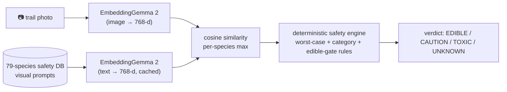

# TrailSnack — the offline trail companion that never says "eat this"

> Point your phone at a wild berry, plant, or mushroom with zero bars of signal.
> TrailSnack identifies it with Gemma AI running entirely on your device, then
> checks the result against a bundled safety database whose default answer is
> **"Unidentified — do not ingest."**

[](https://dev.to)
[](https://dev.to)
[](https://render.com)
[](./LICENSE)

**Live demo:** `https://trailsnack.onrender.com` — *the author sets the final URL
after the first Render deploy (see Post-deadline commits below).*

## What TrailSnack does and how it gets people outside

TrailSnack is an offline-first mobile web app for hikers and trail foragers. On a
remote trail with no cell reception, you photograph a berry cluster, a mushroom,
or an unfamiliar leaf. The app embeds your photo with a Gemma model running
locally in the browser, matches it against a bundled reference database of 79
species, and shows a verdict — EDIBLE, CAUTION, TOXIC, or UNKNOWN — alongside
hazardous lookalikes, a tap-to-tick field checklist, the exact rules behind the
verdict, and offline emergency numbers for your region.

It gets people outside because it removes the two excuses that keep foraging
curiosity on the couch: "there's no signal out there" and "I'm afraid I'll pick
the wrong thing." The first setup downloads the identification model once over
Wi-Fi; after that the whole app works in airplane mode. And the fear is handled
honestly: the app never declares anything safe, lists the deadly lookalikes
first, and makes every checklist item something you confirm with your own eyes
on the trail — not with a tap.

## Safety first

The explicit promise, in plain language:

1. **The app never declares anything safe to eat.** The strongest verdict,
   EDIBLE, reads "Edible per reference, verify every checklist item" and is only
   reachable for non-mushroom species with a confident, clean match. No wild
   mushroom is ever confirmed by the app — mushrooms cap at CAUTION.
2. **The default is "do not ingest."** Unknown photos, low similarity, and any
   ambiguity resolve to UNKNOWN with the headline "Unidentified — do not ingest."
3. **The worst case wins.** If a deadly species is anywhere in the plausible
   matches — or is a listed lookalike of the top match — the verdict is TOXIC.
   A second AI opinion (Tier 2 "Deep Look") can only make verdicts more cautious,
   never less. Model output is advisory input to a deterministic engine; the
   engine alone computes verdicts.

## How Gemma powers it

**Tier 1 "Field ID" (default, ≈280 MB): EmbeddingGemma 2 zero-shot retrieval.**
Your photo is embedded into EmbeddingGemma's shared 768-dimensional space. The
safety database ships 3–6 visual descriptions per species ("whole shrub",
"fruit close-up", "leaf detail", "growth habit"); their text embeddings are
computed once on-device with the model's documented retrieval-document prefix
(`title: {common name} ({scientific name}) | text: {visual prompt}`), cached in
IndexedDB, and matched by cosine similarity. The identification vocabulary is
exactly the set of species the safety engine knows — there is no open-ended
labeling that could invent an edible answer.



**Tier 2 "Deep Look" (opt-in, ≈3.3 GB, WebGPU only): Gemma 4 E2B constrained
feature verification.** For a closer look, Gemma 4 describes only what is
visible in the photo as constrained JSON (cap color, gill attachment, stem
ring, berry cluster shape…) against the top candidates' checklists, with output
grammar-constrained to a fixed schema. It is explicitly forbidden from saying
anything is safe, and its output can only downgrade the Tier 1 verdict.

Both tiers run in a dedicated Web Worker (`src/workers/gemma.worker.ts`) with a
typed message protocol; the main thread never imports the ML library. Weights
live in the Cache API under Transformers.js's own cache, the ONNX Runtime
binaries are self-hosted in `public/ort/` (never a CDN), and precache + WASM
multithreading use cross-origin isolation headers.

## Why open innovation matters here

There is no API on a ridgeline. A cloud-vision foraging app is a contradiction:
where you most need identification, you have the least connectivity, and
roaming fees, dead batteries, and privacy worries follow any photo you upload.
Open weights change the equation completely — Apache-2.0 Gemma models plus the
open-source Transformers.js runtime mean the entire intelligence of this app
ships as static files, runs privately on the hiker's own hardware, costs
nothing per query, and keeps working when the trail goes dark. That is only
possible because the weights and the runtime are open. TrailSnack itself is
Apache-2.0 for the same reason.

## Architecture

```
trailsnack/
├── public/data/flora_safety_db.json  # 79 species, 12 universal rules, emergency numbers
├── public/ort/                       # self-hosted ONNX Runtime (generated, git-ignored)
├── src/ai/                           # gemmaClient, device detection, progress aggregation
├── src/workers/                      # protocol + Gemma Web Worker (only ML importer)
├── src/engine/                       # safetyEngine, thresholds, ranking, schemas
├── src/db/                           # idb: fieldLog, embeddings, settings, manifests
├── src/stores/                       # zustand: model, settings, scan draft
├── src/pages/ + src/components/      # Welcome, Scan, Assess, Log, Models, Settings
├── scripts/                          # copy-ort, validate-db, verify-build, smoke, calibrate, offline
└── tests/unit + tests/e2e            # vitest + Playwright (mocked-worker flows)
```

**Data flow:** camera/file → square 1024px frame → worker (embed → cosine rank
over cached species matrix) → `computeVerdict(scores, db, {deepLook?, region})`
→ badge + candidates + lookalikes + checklist + reasons + emergency → optional
save to IndexedDB field log (photo, verdict, GPS, notes) with JSON/CSV export.

**Storage model:** IndexedDB `trailsnack` v1 (`fieldLog`, `speciesEmbeddings`,
`settings`, `modelManifest`); Cache API `transformers-cache` for weights;
`navigator.storage.persist()` requested at setup; a quota inspector shows usage,
persistence state, and per-model bytes.

**Offline strategy:** Workbox precaches the app shell, `ort/` binaries, and the
database JSON; model weights persist in the Cache API; COOP/COEP headers enable
multithreaded WASM. Verified by `npm run check:offline` (headers, zero CDN
hosts, airplane-mode reload, DB served from SW).

**Cross-origin isolation:** `Cross-Origin-Opener-Policy: same-origin` +
`Cross-Origin-Embedder-Policy: require-corp` on dev, preview, and Render.

## Run locally

Requires Node ≥ 22.

```bash
git clone <this-repo> && cd trailsnack
npm ci
npm run validate:db   # database checks
npm test              # 23 unit tests
npm run build         # typecheck + PWA build + verify-build
npm run test:e2e      # 7 Playwright flows (mocked Tier 1)
npm run check:offline # airplane-mode verification
npm run dev           # local dev server
```

`npm run test:smoke` runs Tier 1 for real in Node (one-time ≈280 MB download)
against fixture photos. `npm run calibrate -- --dir … --labels …` sweeps
thresholds on labeled photos.

## Test

| Suite | Command | What it proves |
|---|---|---|
| Unit (Vitest) | `npm test` | engine rules, idb round-trips, ranking math, progress, Deep Look parser, badge rendering |
| E2E (Playwright) | `npm run test:e2e` | disclaimer gate, each verdict via file upload, save → reload → export, Models quota + Tier 2 gate |
| Smoke (Node) | `npm run test:smoke` | real EmbeddingGemma weights produce normalized 768-d embeddings + sane rankings |
| Offline | `npm run check:offline` | COOP/COEP, no CDN traffic, airplane-mode reload, DB from SW |

## Deploy to Render

1. Push this repo to GitHub.
2. In Render: New → Blueprint → select the repo (`render.yaml` at root defines a
   static site: `npm ci && npm run build`, publish `./dist`, SPA rewrite, COOP/COEP
   and cache headers, PR previews on).
3. Set the service URL, then replace the live-demo URL at the top of this README
   and in `docs/DEV_POST.md`. iOS note: installed via Add to Home Screen, storage
   persists through the TrailSnack persistence prompt in Models.

## Device support matrix

| Device | Tier 1 Field ID | Tier 2 Deep Look |
|---|---|---|
| Chrome Android (WebGPU) | ✅ q4f16 | ✅ (≈3.3 GB, opt-in) |
| Safari 26+ iOS (WebGPU) | ✅ q4f16 | ✅ where memory allows |
| Desktop Chrome/Edge | ✅ q4f16 | ✅ |
| Any modern browser (WASM) | ✅ q4 fallback | ❌ WebGPU-only by design |

## How OpenCode built this

This repository was built autonomously by an AI coding agent — **Muse Spark 1.3
running in OpenCode** — from an empty directory to a verified production build,
with no human in the loop. The full journal is [`docs/AGENT_LOG.md`](./docs/AGENT_LOG.md):
every phase, every command that mattered, every failure and fix. Key decisions
are in [`docs/DECISIONS.md`](./docs/DECISIONS.md) (TypeScript pin, ORT
self-hosting object form, the verdict-tension resolution D-005, and more).
Optional Entire/DevRelay session link: *[author pastes the shared agent session
URL here]*.

## Trail Test Log

*The single author-fill section: complete after a real hike with the deployed app.*

| Date | Trail | Device | Specimens scanned | Verdicts | Notes |
|---|---|---|---|---|---|
| | | | | | |
| | | | | | |

## Dataset provenance and limitations

The 79-species reference was authored by the build agent from general
field-guide knowledge — see [`docs/SOURCES.md`](./docs/SOURCES.md) for
categories, technical sources, and credits. **It has not been reviewed by a
qualified expert and must not be relied on.** Thresholds in
`src/engine/thresholds.ts` are initial values awaiting field calibration
(`npm run calibrate`). Tier 2 was verified by types, mocked tests, and UI gates
— not with real 3.3 GB weights during the build. Known limitations are listed
honestly in the final build report inside `docs/AGENT_LOG.md`.

## Credits

Google DeepMind (Gemma), Hugging Face (Transformers.js, `onnx-community` ONNX
exports), Lucide icons, Render hosting. Non-trivial open-source use is credited
in [`docs/SOURCES.md`](./docs/SOURCES.md).

## Post-deadline commits

Commits after the DEV submission (2026-10-11 23:59 PDT) will be noted here with
dates. At submission time this section is empty by definition.

## License

Apache-2.0 — see [LICENSE](./LICENSE).
